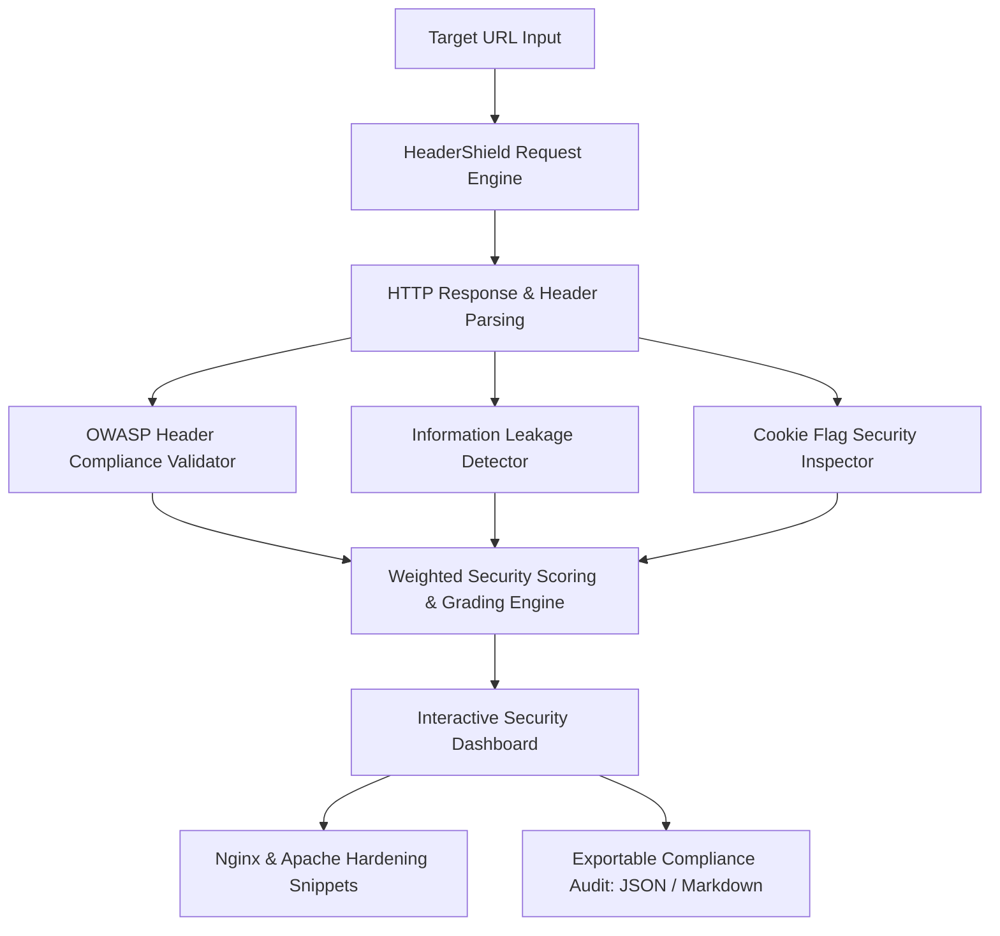

# 🛡️ HeaderShield — Website Security & HTTP Header Auditor

[](https://www.python.org/)
[](https://streamlit.io/)
[](https://owasp.org/)
[](LICENSE)

**HeaderShield** is an automated web application security posture auditor designed to evaluate HTTP response headers against OWASP security benchmarks. It audits critical defensive headers (HSTS, CSP, X-Frame-Options, Permissions-Policy), inspects session cookies for `Secure` and `HttpOnly` attributes, detects sensitive server information leaks (`Server`, `X-Powered-By`), calculates an objective **A+ to F** security grade, and generates copy-paste hardening snippets for Nginx and Apache.

---

## 🌟 Key Features

- **🛡️ OWASP Header Compliance Audit**:
  - `Content-Security-Policy` (CSP) — XSS and code injection defense.
  - `Strict-Transport-Security` (HSTS) — SSL stripping and HTTPS downgrade protection.
  - `X-Frame-Options` — Clickjacking mitigation.
  - `X-Content-Type-Options` — MIME-type sniffing suppression.
  - `Referrer-Policy` — Information leakage prevention across navigation.
  - `Permissions-Policy` — Hardware API restriction (camera, microphone, geolocation).
  - `Cross-Origin-Opener-Policy` (COOP) — Cross-origin isolation.
- **🍪 Cookie Hygiene Inspector**: Evaluates `Set-Cookie` directives for `Secure`, `HttpOnly`, and `SameSite` flags.
- **🕵️ Information Disclosure Radar**: Detects exposed runtime frameworks (`Server`, `X-Powered-By`, `X-AspNet-Version`, `X-Generator`) that assist attackers during technology profiling.
- **🏆 Dynamic Security Letter Grade**: Computes an authoritative **A+ to F** rating and 0–100 numerical score based on weighted defensive impact.
- **🛠️ Automated Server Hardening Snippets**: Provides instant copy-paste directives for **Nginx** and **Apache** web servers.
- **📑 Multi-Format Audit Reports**: Download structured compliance reports in **JSON** or **Markdown**.

---

## 🏗️ System Architecture



---

## 🚀 Quick Start Guide

### Prerequisites
- Python 3.9 or higher installed.

### 1. Clone the Repository
```bash
git clone https://github.com/YOUR_USERNAME/HeaderShield-WebsiteSecurityAuditor.git
cd HeaderShield-WebsiteSecurityAuditor
```

### 2. Set Up Virtual Environment
```bash
# Windows
python -m venv venv
venv\Scripts\activate

# macOS / Linux
python3 -m venv venv
source venv/bin/activate
```

### 3. Install Requirements
```bash
pip install -r requirements.txt
```

### 4. Run HeaderShield
```bash
streamlit run app.py
```
Open your browser at `http://localhost:8501`.

---

## 📁 Project Structure

```
HeaderShield-WebsiteSecurityAuditor/
│
├── app.py                 # Core Streamlit web security auditor
├── requirements.txt       # Project dependencies
├── README.md              # Project documentation & GitHub showcase
└── PROJECT_REPORT.md      # Comprehensive academic & technical report
```

---

## 🛡️ License
Distributed under the MIT License. See `LICENSE` for details.
